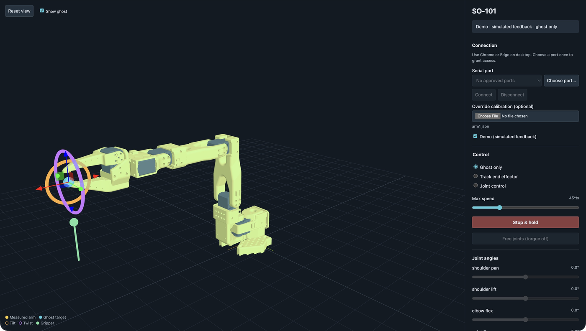

# SO-101 controller

[Open the controller](https://qwertpas.github.io/so101/) in desktop Chrome or Edge.

Control an SO-101 robot arm directly through its USB servo adapter, with a 3D preview, end-effector targets, and individual joint controls.

1. Connect the arm's servo bus and its required power supply to the USB servo adapter, then connect the adapter to your computer. Close other apps using the adapter.
2. Use **Override calibration** if your arm needs a different LeRobot calibration JSON; the bundled default is for this project's arm.
3. Click **Choose port…**, select the adapter, then click **Connect**. The controller starts in **Ghost only** for previewing targets.
4. Select **Track end effector** to follow the target handles, or **Joint control** to use joint sliders. Drag the target arrows to move, the rings to tilt or twist, and the green handle to open or close the gripper.
5. Use **Stop & hold** to stop motion. Support the arm before selecting **Free joints (torque off)**.

Keep the page visible while moving the arm. Switching tabs stops motion and holds position. Closing the browser or unplugging USB cannot guarantee a stop; there is no collision avoidance or hardware emergency stop in the app.

Choose **Demo** to try the controls without hardware.
